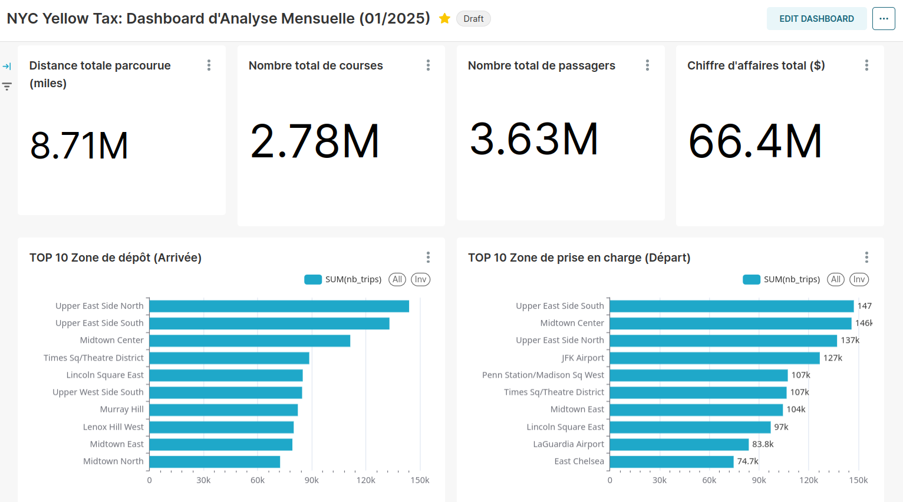
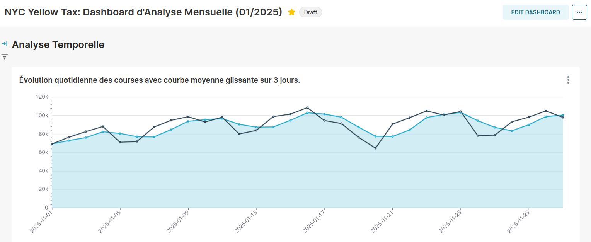
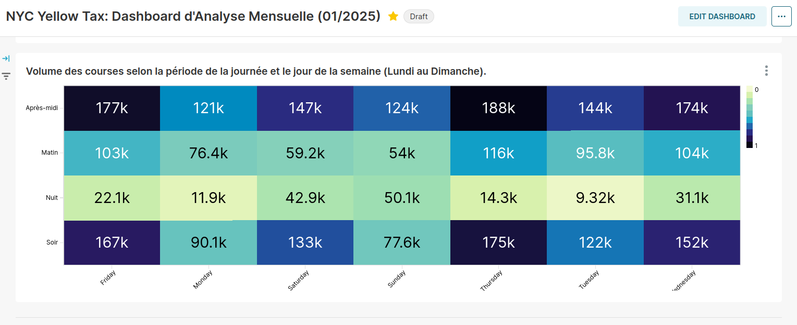
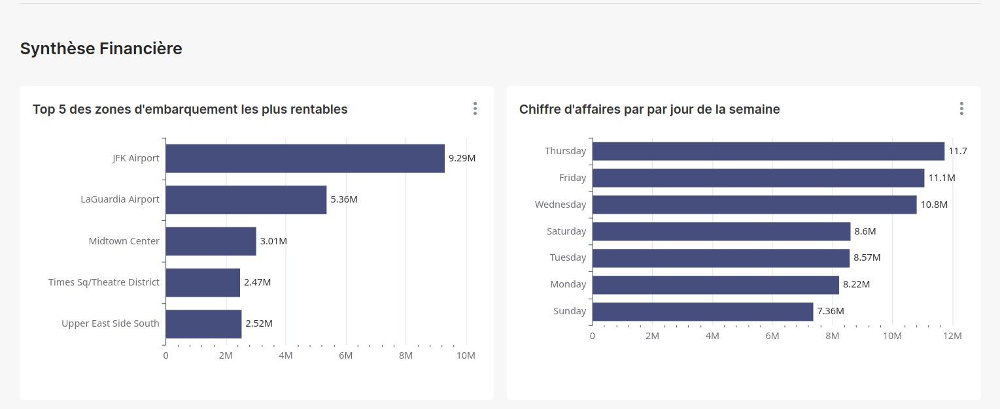

# NYC Yellow Taxi - Analyse de janvier 2025

Ce projet analyse les courses des **Taxis Jaunes de New York** du mois de **janvier 2025**, à partir des données officielles de la *Taxi and Limousine Commission* (TLC) :
https://www.nyc.gov/site/tlc/about/tlc-trip-record-data.page

Le traitement est réalisé avec **Spark** et la visualisation avec **Superset**, le tout orchestré par Docker Compose.

## Démarrage

```bash
mkdir -p jars
curl -o jars/postgresql-42.7.3.jar \
  https://jdbc.postgresql.org/download/postgresql-42.7.3.jar

docker compose up -d

# Lancer le traitement Spark
docker exec -it spark /bin/bash -c "cd /code && /opt/spark/bin/spark-submit --master local[*] app.py"
```

## Interfaces

- Spark UI : http://localhost:4040
- Superset : http://localhost:8088/

## Démo









## Dataset

Le jeu de données utilisé couvre **uniquement janvier 2025** (fichier des trajets Yellow Taxi de ce mois) ainsi que la table de correspondance des zones.

### 1. Table des zones (taxi_zones)

Fait la correspondance entre les identifiants de zone et les lieux réels de New York.

- **LocationID** : identifiant unique de la zone (à lier avec `PULocationID` et `DOLocationID`).
- **Borough** : arrondissement (Manhattan, Brooklyn, Queens, Bronx, Staten Island, EWR).
- **Zone** : nom du quartier (ex : Times Square, JFK Airport, Astoria).
- **service_zone** : type de zone de service (Yellow Zone, Boro Zone, Airports).

### 2. Table des trajets (yellow_taxi_trips)

**Temps et logistique**

- **VendorID** : fournisseur de la technologie embarquée (1 = Creative Mobile Technologies, 2 = VeriFone).
- **tpep_pickup_datetime** : date et heure de prise en charge (heure locale NYC, `timestamp_ntz`).
- **tpep_dropoff_datetime** : date et heure de dépose.
- **passenger_count** : nombre de passagers déclaré par le chauffeur.
- **store_and_fwd_flag** : trajet stocké dans le taxi avant transmission faute de réseau (Y = oui, N = non).

**Trajet et géographie**

- **trip_distance** : distance de la course en **miles**, mesurée par le taximètre.
- **RatecodeID** : code tarifaire final (1 = Standard, 2 = JFK, 3 = Newark, 4 = Nassau/Westchester, 5 = Tarif négocié, 6 = Groupe).
- **PULocationID** : zone de **départ** (Pick-Up), jointure avec `LocationID`.
- **DOLocationID** : zone d'**arrivée** (Drop-Off), jointure avec `LocationID`.

**Paiement et tarification de base**

- **payment_type** : mode de règlement (1 = Carte, 2 = Espèces, 3 = Gratuit, 4 = Litige, 5 = Inconnu, 6 = Annulé).
- **fare_amount** : prix de base calculé selon le temps et la distance.
- **extra** : suppléments divers (ex : 0,50 $ de nuit, 1 $ aux heures de pointe).

**Taxes, suppléments et totaux**

- **mta_tax** : taxe fixe de 0,50 $ pour la *Metropolitan Transportation Authority*.
- **tip_amount** : pourboire. Seuls les pourboires payés par **carte** sont enregistrés, pas ceux en espèces.
- **tolls_amount** : péages (ponts et tunnels) cumulés pendant le trajet.
- **improvement_surcharge** : taxe fixe de 0,30 $ par trajet.
- **congestion_surcharge** : surcharge de congestion du trafic urbain de New York.
- **Airport_fee** : frais fixes pour les prises en charge ou déposes dans les aéroports (LaGuardia / JFK).
- **cbd_congestion_fee** : taxe pour la zone du *Central Business District* (Manhattan, au sud de la 60e rue).
- **total_amount** : somme facturée au client (hors pourboires en espèces).